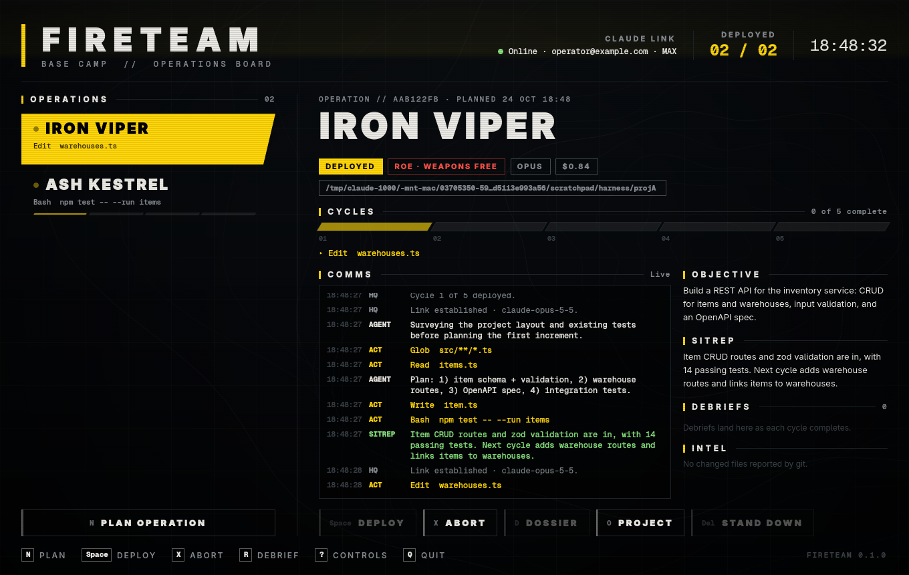

# Fireteam



A base camp for Claude Code agents, styled like a shooter's main menu. Plan an
operation (a project directory, an objective, and a number of cycles), deploy
it, and a headless `claude` agent works through the cycles one after another.
Each cycle resumes the previous cycle's session and files an HTML debrief.
Several operations can be deployed at once, each with its own agent.

Agents use the Claude Code login already on the machine (`claude auth status`
is shown in the header as the Claude link). No API key is needed beyond that.

## What you get per operation

- **Comms**: the agent's live stream (what it says and every tool it uses).
- **Sitrep**: the agent's summary at the end of the latest cycle.
- **Debriefs**: one HTML report per cycle. The agent writes it; if it doesn't,
  Fireteam writes one from the comms so no cycle goes unreported.
- **Dossier**: an HTML index of every cycle's sitrep and debrief.
- **Intel**: changed files, from `git status`, when the project is a repository.

Everything Fireteam keeps lives in `~/.local/share/fireteam/`. The project
directory is only touched by the agent itself.

## Rules of engagement

| ROE | `claude` permission mode | Meaning |
| --- | --- | --- |
| Restricted | `acceptEdits` | Edits files; other commands follow your Claude Code permission settings, and anything not pre-approved is refused |
| Weapons free | `bypassPermissions` | Runs any command without asking |

## Controls

| Key | Action |
| --- | --- |
| `N` | Plan a new operation |
| `Space` | Deploy, resume, or redeploy (+1 cycle) the selected operation |
| `X` | Abort the selected operation |
| `↑` `↓` / `J` `K` | Move through the roster |
| `R` | Open the latest debrief |
| `D` | Open the dossier |
| `O` | Open the project directory |
| `Del` | Stand down (remove) the operation |
| `Ctrl+Enter` | Deploy from the briefing |
| `Esc` | Close a panel |
| `?` | Show the controls |
| `Q` | Quit (asks first while agents are deployed) |

## Command line

```sh
fireteam              # open the board
fireteam status       # list operations
fireteam status --json
```

## Build

```sh
bin/build     # build/fireteam
bin/test      # tests, offscreen, with a fake claude
bin/install   # package and install, so it shows in the launcher
```
